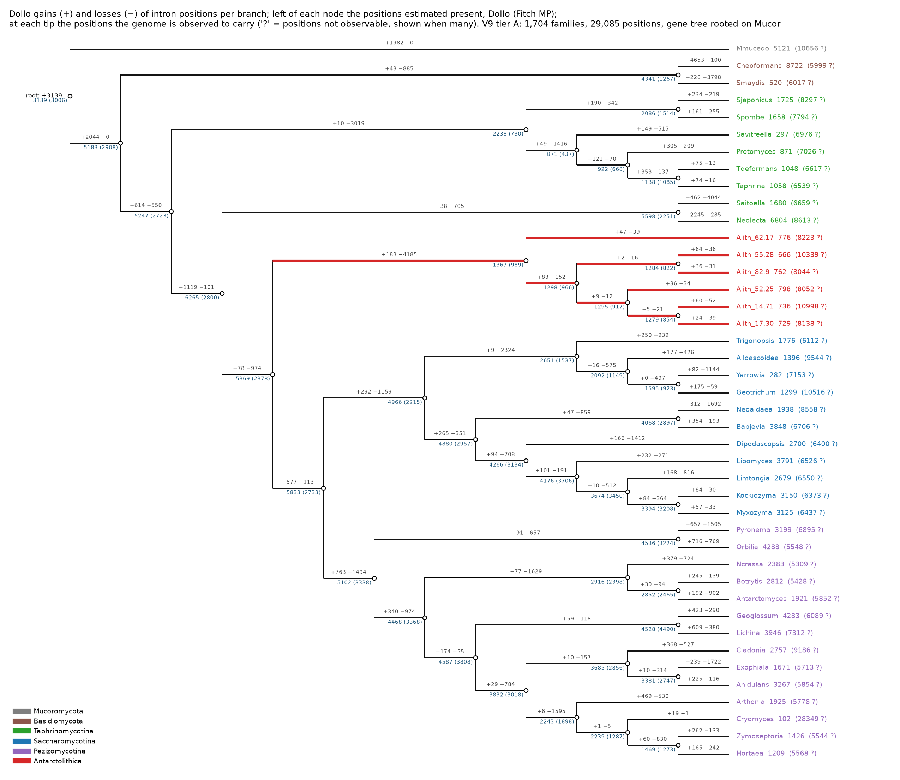
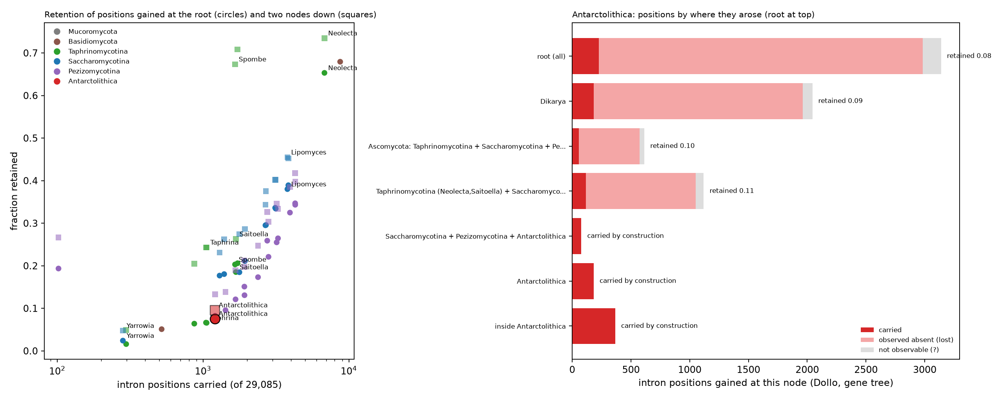
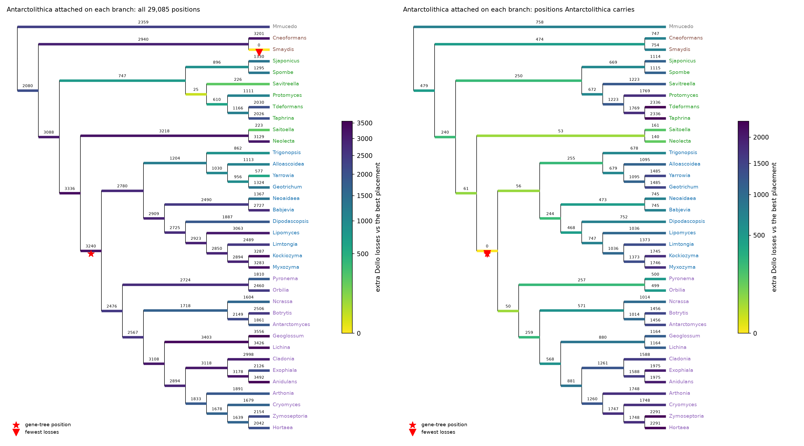
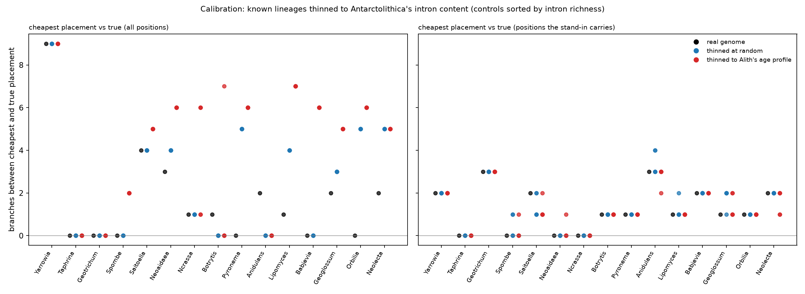
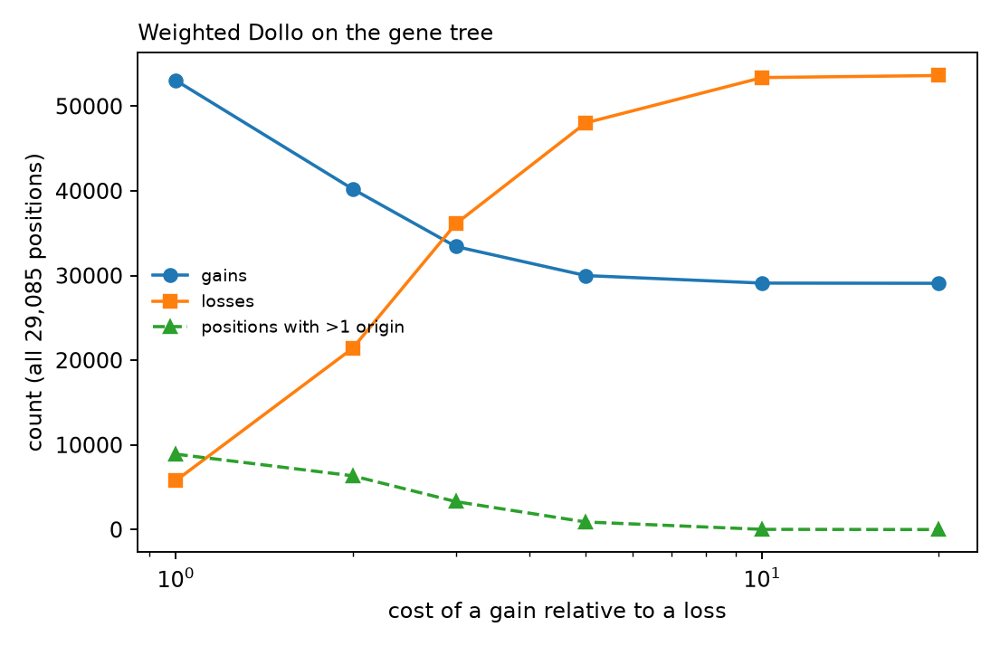

# V13: where *Antarctolithica*'s introns map on the tree, and what they say about its position

*Antarctolithica obscura* (6 Mars strains, BFD funannotate models of MAG assemblies; "Alith") on the V9 tier-A matrix: 42 genomes,
1,704 single-copy families, 29,085 intron positions. This step maps every Alith intron position onto Dollo gains, losses and
ancestral states, asks which candidate placements the positions favour, and calibrates that test with known lineages thinned to Alith's
intron content. Everything ran on the HPCC (job 32078534, 10 min; figures with `pixi`); the small tables are in `results/`, the
figures in `figures/`. **Purgeable on the HPCC:** `score/` (747 MB), `calib/`, `logs/`, `.pixi/`.

## The questions, answered briefly

| Question | Answer |
|---|---|
| Which model? | **Parsimony, not likelihood.** Classic Dollo: each position arises once, at the common ancestor of the genomes that carry it, and the number of losses is minimised. Also Fitch maximum parsimony (gains and losses equal cost) and the weighted Dollo sweep (`-m dollo_weighted`, Figure 5). `intronfate` has no likelihood model. |
| Gene-model error in the model? | **Not inside it.** Errors enter only as sensitivity analyses outside the scoring: V4 measured how accurate the annotations are, V7 simulated how far missed introns could move the loss counts, and the calibration below thins genomes on purpose. A model that includes error would be a likelihood model in which each genome's tips are observed through its own miss and false-intron rates (see "Next steps"). |
| Outgroup? | *Mucor mucedo* (Mucoromycota). The tree is the OrthoFinder species tree rooted on *Mucor* (V9 `make_trees.py --root-on Mmucedo`), with the basidiomycetes *C. neoformans* and *M. maydis* as the sister of Ascomycota. |
| If Alith's position is uncertain, do positions favour different placements? | Yes, and how they do depends on whether the absences are counted. **Absences** (21,093 positions Alith lacks) pull Alith next to other intron-poor genomes (*M. maydis*, Taphrinomycetes, *Saitoella*, *Yarrowia*). The calibration shows this pull is an artefact. The **1,208 positions Alith carries** favour the gene-tree position, sister to Saccharomycotina + Pezizomycotina. The calibration shows this test errs only towards the root, so the true position is there or shallower (sister to Pezizomycotina or to Saccharomycotina are close behind). |

## 1. Gains, losses and ancestral states on the gene tree



**Figure 1.** On each branch, Dollo gains (+) and losses (−) of intron positions. Left of each node, the number of positions estimated
present at that ancestor: Dollo, then Fitch MP in brackets. At each tip, the positions the genome is observed to carry; "?" counts positions
in families or alignment regions where it cannot be observed.

| Node | Dollo present | MP present | Per family (Dollo) |
|---|---|---|---|
| root (Mucoromycota + Dikarya) | 3,139 | 3,006 | 1.8 |
| Dikarya | 5,183 | 2,908 | 3.0 |
| Ascomycota | 5,247 | 2,723 | 3.1 |
| Saccharomycotina + Pezizomycotina + Alith | 5,369 | 2,378 | 3.2 |
| Saccharomycotina + Pezizomycotina | 5,833 | 2,733 | 3.4 |
| **Alith ancestor (6 strains)** | **1,367** | **989** | **0.8** |
| Alith strains (observed) | 666-798 each, 1,208 in at least one | | 0.4-0.5 |

- **The Alith stem** carries 183 gains and **4,185 losses**, the largest loss count of any branch on the tree (next: *Saitoella* 4,044, *M. maydis* 3,798). Under
  Dollo, Alith's ancestor kept about a quarter of the positions present at its parent (1,367 of 5,369).
- **Dollo and MP differ by a factor of two at deep nodes.** Classic Dollo places a gain at the common ancestor of the carriers, so it gives
  ancestral counts that are as high as possible. Fitch MP allows parallel gains and gives lower counts. The true values are likely between
  the two; a likelihood model would give a probability per node.
- **Within the six strains**, 366 positions are carried by only some of them (0-64 gains per strain branch). Individual strains carry
  666-798 positions; the union of the six is 1,208. Variable annotation of the MAGs explains this better than real recent gains. Treat the
  strain-level branches as noise, and the 1,208 as an upper bound for Alith's content.

## 2. Where Alith's introns came from

| Gained at (Dollo, gene tree) | Alith carries | lacks | not observable | Retention |
|---|---|---|---|---|
| root (all Fungi here) | 226 | 2,758 | 155 | 0.08 |
| Dikarya | 184 | 1,777 | 83 | 0.09 |
| Ascomycota | 55 | 519 | 40 | 0.10 |
| *Neolecta* + *Saitoella* + Saccharomycotina + Pezizomycotina + Alith | 116 | 935 | 68 | 0.11 |
| Saccharomycotina + Pezizomycotina + Alith | 78 | — | — | by construction |
| Alith stem | 183 | — | — | by construction |
| within Alith | 366 | — | — | by construction |

"By construction": Dollo puts a gain at the common ancestor of the carriers, so a position gained at Alith's parent node, on its stem or
inside it is carried by Alith by definition. Only the four older classes measure retention. In those, Alith keeps 8-11 % of the positions,
slightly more of the younger layers (0.08 for root-age positions, 0.11 for the youngest measurable class).



**Figure 3.** Left: retention of positions gained at the root (circles) and two nodes down (squares), against how many positions a genome
carries; one point per lineage. Retention rises with intron richness for every group. Among genomes carrying 1,000-2,000 positions, Alith's root-age retention
(0.076) is with the lowest: *Taphrina* and *T. deformans* 0.066, the black yeasts *Hortaea* 0.083 and *Zymoseptoria* 0.096, against 0.12-0.15
for other Pezizomycotina and 0.18-0.21 for Saccharomycotina, *Saitoella* and the fission yeasts. So for its intron count, Alith holds few
ancient positions, and a large share of its content is lineage-specific (549 of 1,208 gained on the stem or inside). That share is
inflated by the annotation noise above. Low deep retention at a given richness is shared by unrelated groups here, so it is not a
placement signal. Right: Alith's positions by the node where they arose.

## 3. Which placements do the positions favour?

V9 attached Alith on each of the 70 branches of the backbone (the gene tree without Alith). Every one of those trees was scored here.



**Figure 2.** Extra Dollo losses of attaching Alith on each branch, compared with the best branch. Left: all positions. Right: only the
positions Alith carries. Star: the gene-tree position. Triangle: the fewest losses.

| Alith attached as sister of | Δ Dollo losses, all positions | Δ Dollo losses, Alith-carried positions | Δ MP steps |
|---|---|---|---|
| *M. maydis* (basidiomycete) | **0** | 754 | 85 |
| *Saitoella* | 223 | 161 | 600 |
| Taphrinomycetes (6 of 8) | 747 | 250 | 180 |
| **Saccharomycotina + Pezizomycotina (gene tree)** | 3,240 | **0** | 381 |
| Pezizomycotina (published CAT placement) | 2,476 | 50 | 480 |
| *Neolecta* + *Saitoella* | 3,218 | 53 | 383 |
| Saccharomycotina | 2,780 | 56 | 506 |
| *Neolecta* + *Saitoella* + Saccharomycotina + Pezizomycotina | 3,336 | 61 | 327 |
| *Neolecta* | 3,129 | 140 | 494 |
| all Ascomycota except Alith | 3,088 | 240 | 279 |

(Full table: `results/placement_support.tsv`; the MP optimum is inside the Taphrinomycetes, Δ 0, `place_08`.)

- **Over all positions**, absences decide. 21,093 positions are observed absent in Alith. Attaching it next to the most intron-poor genome
  (*M. maydis*, 520 positions) makes those absences cheapest. The other low-cost placements are also intron-poor (*Saitoella* after its
  4,044-loss branch, *Savitreella*, *Yarrowia*, the Taphrinomycetes). This is the attraction that V8 and V9 described, and the calibration
  below reproduces it.
- **Over the 1,208 positions Alith carries**, the gene-tree position is cheapest. Four other placements are within 61 losses: sister to
  Pezizomycotina, to *Neolecta* + *Saitoella*, to Saccharomycotina, and to all of these together. Of the 653 carried positions that
  distinguish placements at all, 599 are equally cheap on more than five branches and only 46 point to a single branch. The largest of
  those single-branch groups is **22 positions whose only cheapest placement is next to *Neolecta***, a small but specific signal towards the Taphrinomycotina side
  (`results/site_preference.tsv`).

## 4. Calibration: what does the test do to an intron-poor lineage whose position is known?

Fifteen control lineages were tested, from 282 to 6,804 carried positions. For each one, Alith and the control were both removed, and the
control was then attached on every branch of the remaining tree. Its intron presences were thinned to Alith's level in three ways:
- **real genome**: no thinning;
- **at random**: keep probability = 1,208 / its carried count;
- **Alith's age profile**: positions older than its parent node kept so that their retention matches Alith's 0.088, and its own-branch
  positions kept to Alith's 549.

Each thinned variant was repeated five times. A thinned intron becomes an observed absence, as a real loss would.

| Test | Variant | Runs | Cheapest = true | Pulled to an intron-poor genome | When wrong |
|---|---|---|---|---|---|
| all positions | real genome | 15 | 6 | 2 | either direction |
| all positions | at random | 75 | 30 | 25 | either direction, often far (up to 9 branches) |
| all positions | Alith's age profile | 75 | 19 | **54** | towards *M. maydis*, Taphrinomycetes, *Saitoella*, *Yarrowia* |
| carried positions only | real genome | 15 | 4 | 0 | 9 deeper, 2 same depth, **0 shallower** |
| carried positions only | at random | 75 | 18 | 0 | 50 deeper, 7 same depth, **0 shallower** |
| carried positions only | Alith's age profile | 75 | 18 | 0 | 53 deeper, 4 same depth, **0 shallower** |



**Figure 4.** Branches between the cheapest and the true placement for each control (sorted by intron richness). Left: all positions.
Right: carried positions only.

What this means for Alith:
1. **The all-positions result (sister to *M. maydis*) is the artefact the calibration predicts.** Genomes thinned to Alith's profile were
   pulled to the same intron-poor genomes in 54 of 75 runs. It is not evidence for a basidiomycete or Taphrinomycete affinity.
2. **The carried-positions test is one-sided.** It never placed a lineage shallower than its true position. When wrong (about 3 runs in 4),
   it placed it 1-3 branches deeper, towards the root: a thinned lineage has lost the clade-specific introns that would pull it into its
   own clade. Alith's carried-positions optimum is sister to Saccharomycotina + Pezizomycotina. So its true position is **there or
   shallower**: sister to Pezizomycotina, sister to Saccharomycotina, or (less likely given V9's clade-retention test) inside one of them.
   A position deeper than Saccharomycotina + Pezizomycotina (on the Taphrinomycotina side, or at the base of the Ascomycota) is not
   supported by the carried positions. The 22 positions that point only to *Neolecta* are the one signal in that direction.
3. Combined with V9 (Alith's retention of Pezizomycotina- and Saccharomycotina-defining introns is in the non-member range) and V11 (the
   likelihood optimum is sister to Saccharomycotina + Pezizomycotina; sister to Pezizomycotina is second), the intron evidence brackets
   Alith between "sister to Saccharomycotina + Pezizomycotina" and "sister to Pezizomycotina". **The introns cannot choose between these
   two:** the 50-loss gap is smaller than the bias the calibration shows.

## 5. How sensitive are the counts to "one origin per position"?



**Figure 5.** Weighted Dollo on the gene tree. A gain costs 1-20 times a loss, and a lost position never returns. At 1:1, 8,902
positions get two or more origins and losses fall to 5,794. From 10:1 upward the result is classic Dollo: 29,085 gains (one per position)
and 53,624 losses. Loss counts are therefore only meaningful together with the assumption that parallel gain is rare. The classic-Dollo
numbers above are the upper end.

## Limits

- Funannotate models of MAG assemblies. The strain-to-strain spread (666-798 positions) shows annotation noise at the level of individual
  introns; V7-style error bounds for this set were not computed.
- The thinning in the calibration is random within an age class. Real intron loss is not (3' bias, phase, expression level), and real
  annotation misses add their own pattern. The calibration measures how the test behaves on intron-poor input, not every way it can fail.
- One topology for the backbone (the OrthoFinder gene tree). The Taphrinomycotina are not monophyletic in it; V9's
  Taphrinomycotina-monophyletic variant was not rescored here.
- Dollo and MP are parsimony. They give no probabilities, no branch-length or rate information, and no error model.

## Next steps

1. **A likelihood model with annotation error** (recommended, in `intronfate-core`). A two-state gain/loss process along the tree, with
   rate variation across positions (as in MALIN, Csűrös 2008). Each genome's observed 0/1 is linked to the true state through its error
   rates: P(observed absent | present) = 1 − sensitivity and P(observed present | absent) = false-intron rate, from V4. `?` stays missing.
   This would give:
   - posterior probabilities of presence at every ancestor (Figure 1 with probabilities instead of the Dollo/MP pair);
   - likelihoods for each Alith placement, so a placement test that accounts for Alith's own error rate;
   - expected gains and losses per branch that are not inflated by missed introns.
2. **The BFD set with matched intron-poor controls** (proposed earlier). Include real intron-poor members of each candidate group, so the
   calibration uses real reduced genomes instead of thinned ones.
3. Score V9's Taphrinomycotina-monophyletic backbone and the V11 hypothesis trees the same way, and check the 22 positions that point to *Neolecta*
   by hand (gene, phase, alignment quality).

## Files and how to rerun

| File | What |
|---|---|
| `v13lib.py` | tree and table readers, origin profile, placement support, thinning (fixture tests: `python3 -I tests/test_v13.py`) |
| `analyze.py` | sections 1-3 → `results/ancestral_states.tsv`, `tip_counts.tsv`, `alith_origin.tsv`, `retention_by_origin.tsv`, `placement_support.tsv`, `site_preference.tsv.gz`, `site_support.tsv.gz`, `summary.txt` |
| `calibrate.py`, `run_calibration.sh` | section 4 → `results/calibration_plan.tsv`, `calibration_runs.tsv`, `calibration_summary.tsv` |
| `v13_figures.py`, `run_figures.sh`, `pixi.toml` | Figures 1-5 |
| `results/score_gene_tree/` | `intronfate score` on the gene tree: `dollo_branches.tsv`, `dollo_weighted.tsv`, `summary_score.tsv`, `tree_gains.nwk` |

```sh
cd ~/projects/intron_projector/bench/V13_antarctolithica_intron_map
sbatch run_v13.sbatch                                         # needs an intronfate build with -m dollo_weighted (INTRONFATE=...)
srun -p short -c 2 --mem 8gb --time 0:30:00 bash run_figures.sh
```
