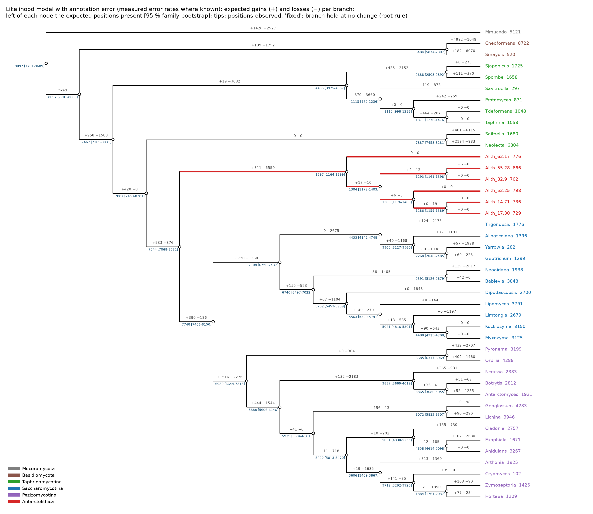
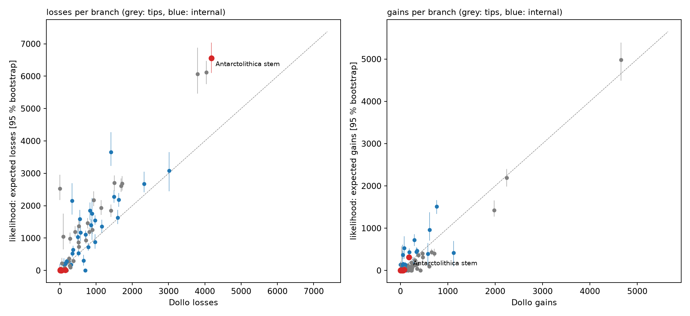
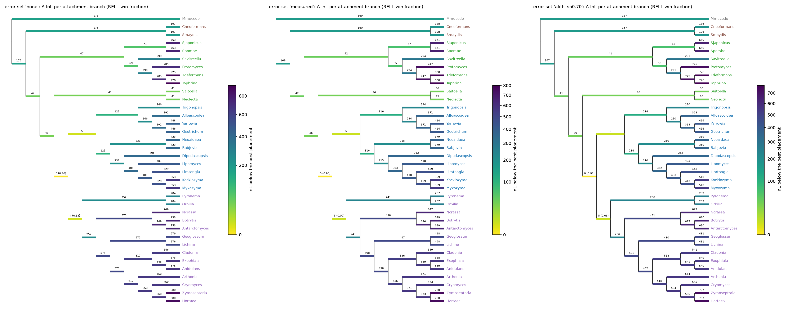

# V14: the likelihood model with annotation error on the Antarctolithica data

V13 mapped *Antarctolithica* (Alith) intron positions with Dollo parsimony. This step refits the same V9 tier-A matrix (42 genomes,
1,704 families, 29,085 positions, gene tree rooted on *Mucor*) with `intronfate score -m likelihood`. That is the probabilistic
gain/loss model with per-genome annotation error (model: [`docs/SPEC.md`](../../docs/SPEC.md) §5.5, usage: [`docs/USAGE.md`](../../docs/USAGE.md) §11).
It ran on the HPCC: job 32080774, 1 h 39 min on 16 cores; code at commit 872ef68 (`repo_commit.txt`; the `git log` line in the job log
shows a different checkout and should be ignored). Small tables are in `results/`, figures in `figures/`.
**Purgeable on the HPCC:** `score/`, `place/`, `logs/`.

## What was run

| Error set (`errors/`) | Sensitivity, false introns |
|---|---|
| `none` | every genome error-free (the model then differs from Dollo only in allowing parallel gains and in being probabilistic) |
| `measured` | V4's intron sensitivity and precision at the V6 tier-A genes for the six V9 genomes that have them (*M. mucedo*, *M. maydis*, *C. neoformans*, *S. pombe*, *N. crassa*, *A. nidulans*); the median of those (0.958 / 0.929) for the other 36, Alith included |
| `alith_sn1.00` … `alith_sn0.70` | as `measured`, with Alith's sensitivity set to 1.0, 0.9, 0.8 and 0.7 (it has no reference annotation) |

- The gene tree was fitted under every set, with 100 family-bootstrap replicates for `measured`.
- All 70 Alith placements from V9 were fitted under `none`, `measured` and `alith_sn0.70`. They are compared by fitted log-likelihood
  and by RELL (each tree's per-position log-likelihoods resampled by family, 1,000 replicates; `rell.py`).
- Every fit converged. A separate check on this matrix (`crates/intronfate-core/tests/ml_realdata.rs`) reached the same optimum from
  three starting points and with a 10,000 times stricter tolerance (log-likelihood spread 0.0000).

## 1. Gains, losses and ancestral states

**Figure 6.** The likelihood model (error set `measured`): expected gains (+) and losses (−) on each branch; left of each node, the
expected number of positions present, with the 95 % family-bootstrap interval in brackets. "fixed" marks the root branch held at no
change: the model's root is the Dikarya ancestor, and all change between *Mucor* and Dikarya is on *Mucor*'s branch.

| | Dollo (V13) | Likelihood, no error | Likelihood, measured error [95 % bootstrap] |
|---|---|---|---|
| Alith stem: gains | 183 | 263 | 311 [247–364] |
| Alith stem: losses | 4,185 | 7,225 | **6,559** [6,105–7,024] |
| Alith ancestor: positions present | 1,367 (MP 989) | 1,298 | **1,297** [1,164–1,399] |
| Its parent (Saccharomycotina + Pezizomycotina + Alith) | 5,369 (MP 2,378) | | **7,544** [7,068–8,032] |
| All branches: losses / gains | 53,624 / 29,085 | 96,715 / 22,625 | 83,602 / 20,331 |
| Never-seen positions (estimated) | — | 276,541 | 129,862 |

(Bootstrap intervals for every branch: `results/branches_measured.tsv`.)

What changes relative to Dollo, and why:
- **Ancestors are richer and losses larger.** Dollo puts each gain as late as possible (at the common ancestor of the carriers), so it
  gives the fewest positions at deep nodes. The likelihood weighs every history by its probability. It places many positions earlier
  and lets them be lost, so deep nodes hold more and losses rise (Figure 7). For Alith, the stem loss count grows from 4,185 to about
  6,500, because its parent is reconstructed with about 7,500 positions instead of 5,400. Alith's own ancestor stays at about 1,300.
- **Modelling annotation error lowers the losses** (96,715 → 83,602 in total) and halves the estimated never-seen positions: some
  absences become misses.
- **Near-identical genomes show no change between them.** With sensitivity about 0.96, small differences between close sisters are
  explained as annotation error. That applies to the six Alith strains (0–19 expected changes per strain branch, against 24–64 Dollo
  gains), *Taphrina* / *T. deformans* and *Kockiozyma* / *Myxozyma*. This supports reading V13's strain-level Dollo events as
  annotation noise.

**Figure 7.** Per branch, Dollo against the likelihood (with 95 % bootstrap intervals). Losses are higher under the likelihood almost
everywhere, most on the long branches of intron-poor lineages. Gains are similar or lower. The grey point at Dollo 0 is *Mucor*'s
branch (the root rules differ).

## 2. How much does Alith's own annotation quality matter?

| Alith sensitivity | Stem losses | Ancestor present | Alith misses expected | lnL |
|---|---|---|---|---|
| 1.0 | 6,561 | 1,279 | 0 | −161,236.4 |
| 0.9 | 6,536 | 1,325 | 188 | −161,392.2 |
| 0.8 | 6,515 | 1,344 | 265 | −161,732.3 |
| 0.7 | 6,502 | 1,356 | 308 | −162,180.9 |

Even if Alith's gene models missed 30 % of its introns, the model would attribute only about 300 of its absences to misses. The stem
still carries about 6,500 losses, and the ancestor rises only from about 1,280 to 1,360 positions. **Alith's intron poverty is not an
annotation artefact** at any plausible sensitivity: the losses are inferred from the other 41 genomes, which carry these positions.
(The log-likelihood falls as the assumed sensitivity drops, so the data fit best with Alith's annotation taken as accurate; this is not
an estimate of its sensitivity.)

## 3. Placement under the likelihood

**Figure 8.** The backbone coloured by how much worse the fitted log-likelihood is with Alith attached on each branch (RELL win fraction
in brackets where ≥ 0.01). One panel per error set.

| Alith sister of | Δ lnL (none / measured / Alith Sn 0.7) | RELL win (none / measured / Sn 0.7) |
|---|---|---|
| **Saccharomycotina + Pezizomycotina** | 0 / 0 / 0 | **0.86 / 0.90 / 0.91** |
| Pezizomycotina | 4.5 / 4.9 / 4.9 | 0.13 / 0.09 / 0.08 |
| Saccharomycotina | 5.1 / 5.2 / 5.2 | 0.01 / 0.01 / 0.01 |
| *Neolecta* + *Saitoella* | 41 / 36 / 36 | 0 |
| all Ascomycota but Alith (its base) | 47 / 42 / 41 | 0 |
| *M. maydis* (the Dollo all-positions optimum) | 197 / 188 / 186 | 0 |
| *Yarrowia* | 448 / 424 / 416 | 0 |

- **No attraction to intron-poor genomes.** Unlike Dollo over all positions (V13), the likelihood does not pull Alith towards *M. maydis*,
  *Yarrowia* or the Taphrinomycetes. Absences are explained by losses with probabilities, and here by errors, not by placing Alith next
  to another genome that lacks the same introns.
- **The ranking matches V13's carried-positions test and V11's sequence likelihood:** sister to Saccharomycotina + Pezizomycotina is
  best, sister to Pezizomycotina second. In V11 the alternatives trailed by hundreds of log-likelihood units on 200,000 amino-acid
  columns; here sister to Pezizomycotina is 4.5–4.9 units worse and wins 8–13 % of family resamples. **The introns lean the same way
  but cannot exclude sister to Pezizomycotina.**
- Positions deeper in the tree (sister to *Neolecta* + *Saitoella*, or at the base of the Ascomycota) are 36–47 units worse and never win. The 22 positions that
  pointed only to *Neolecta* under Dollo (V13) do not outweigh the rest.
- Alith's assumed sensitivity changes nothing in the ranking.

## Limits

- **No rate variation across positions.** Intron positions differ greatly in how readily they are lost and gained. A homogeneous model
  can overstate how rich ancestors were and therefore how many losses occurred (MALIN's rate categories address this; SPEC §5.6). The
  Dollo/likelihood contrast in section 1 is partly this.
- Error rates are measured for only 6 of 42 genomes; the rest use the median. Alith's are unknown (hence the sweep).
- The likelihood placement test is **not calibrated** the way V13 calibrated the Dollo tests (known lineages thinned to Alith's
  content). That would take a likelihood fit per thinned matrix and placement (about 20,000 fits).
- One backbone topology (the OrthoFinder gene tree). RELL ignores the uncertainty of each tree's own parameter fit.

## Files

| File | What |
|---|---|
| `make_error_sets.py` | error-rate files from V4's tables (`errors/`) |
| `rell.py` | fitted lnL per tree and RELL over families |
| `run_v14.sbatch`, `run_figures.sh`, `v14_figures.py` | the job, then tables and Figures 6-8 (V13's pixi environment and tree drawing) |
| `tests/test_v14.py` | fixture tests for the two helpers |
| `results/branches_measured.tsv` | per branch: Dollo and likelihood gains, losses, presence, bootstrap intervals, fixed flag |
| `results/alith_sweep.tsv`, `results/placements.tsv`, `results/rell_*.tsv` | the tables above |
