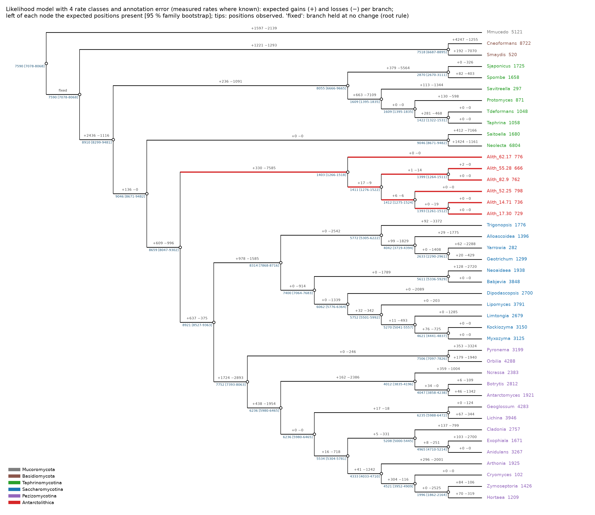
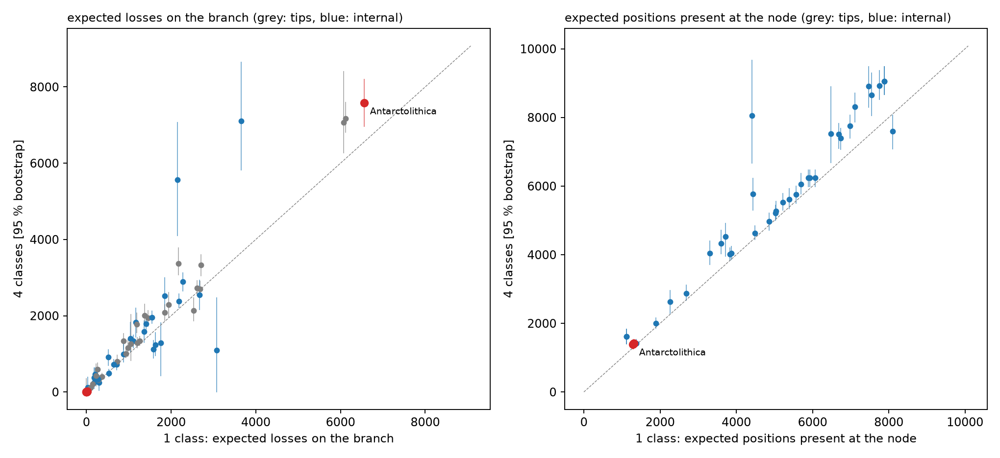
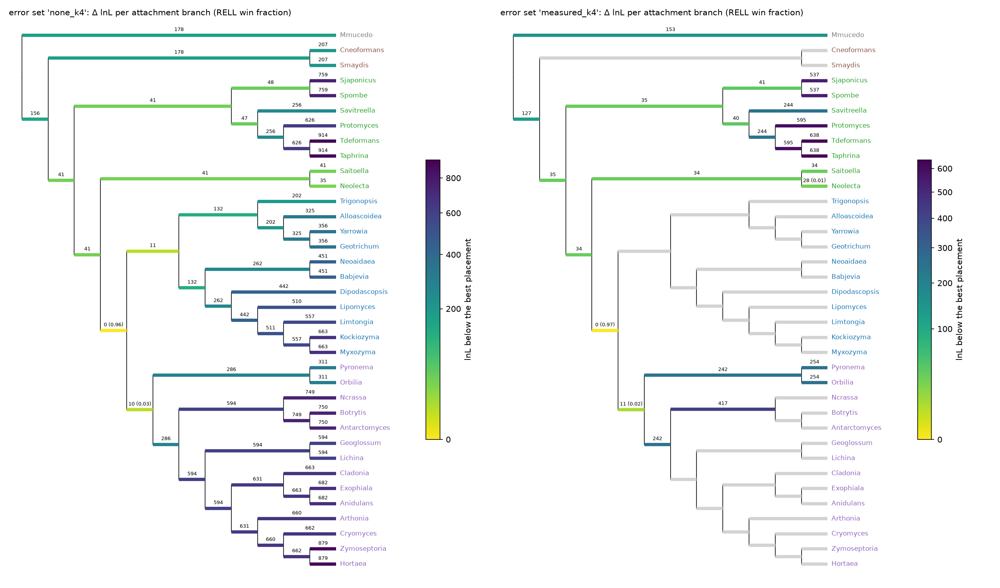
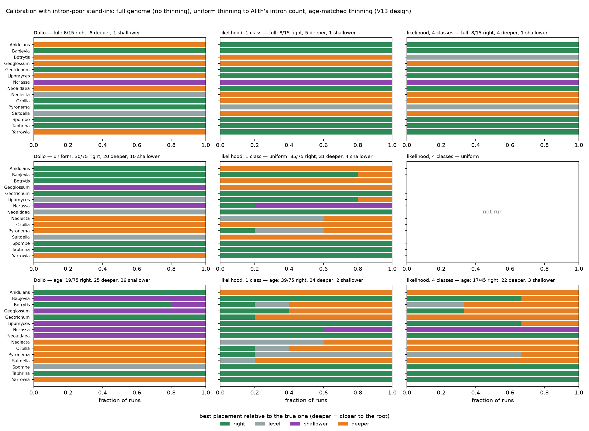

# V15: rate variation across positions, and a calibration of the likelihood placement test

V14 fitted the likelihood model with annotation error to the Antarctolithica (Alith) data with one rate for every intron position.
This step adds **rate variation across positions** (`--ml-rate-categories 4`: four gamma rate classes, shape estimated; model in
[`docs/SPEC.md`](../../docs/SPEC.md) §5.5b). It then repeats V13's **calibration** with the likelihood instead of Dollo: lineages of
known position are thinned to Alith's intron content, and the test is checked for whether it still places them correctly.

- **Data:** the V9 tier-A matrix (42 genomes, 29,085 positions, gene tree rooted on *Mucor*) and V14's error sets.
- **Code:** commits 4b7b37c (rate classes) and 42a2410 (`--ml-param-tol`), see `repo_commit.txt`.
- **Jobs:** HPCC jobs 32090294 (gene tree; its placement step was moved to array 32102226), 32090614 and 32090615 (calibration).
- **Outputs:** small tables in `results/`, figures in `figures/`.
- **Purgeable on the HPCC:** `score/`, `place/`, `calib/`, `calib_v13/`, `repo/`, `logs/`.

## What was run

| Run | Detail |
|---|---|
| Gene tree | Error sets `none`, `measured`, `alith_sn0.70` (V14), each with 1 and 4 rate classes. The `measured` 4-class fit has 100 family-bootstrap replicates. |
| Placements | All 70 Alith attachment points with 4 classes under `none` and `measured`, compared by lnL and RELL (V14's `rell.py`, 1,000 family resamples). |
| Calibration, 1 class | V13's 165 matrices (15 controls × full, 5 uniform-thinned, 5 age-matched-thinned), each fitted on all of its control's ~68 attachment trees: 11,220 fits, no annotation error. |
| Calibration, 4 classes | The 15 full matrices and age-matched replicates 1–3 (60 matrices, 4,080 fits), with `--ml-param-tol 1e-5`. That stops about 0.01 lnL short of full convergence, which is far below the gaps compared here. |

V13's thinned matrices had been deleted. `prepare_calib.sbatch` regenerated them with V13's seeded script and checked that the plan is
identical (`logs/V15prep.*`).

## 1. Rate variation fits much better, and makes ancestors richer

| | 1 class (V14) | 4 classes [95 % bootstrap] |
|---|---|---|
| lnL, `measured` errors | −161,256.3 | **−159,380.5** (+1,876; one extra parameter) |
| Gamma shape α | — | 2.80 (2.78–2.88 across error sets) |
| Alith stem: losses | 6,559 | **7,585** [6,964–8,195] |
| Alith stem: gains | 311 | 330 [268–380] |
| Alith ancestor: positions present | 1,297 | 1,403 [1,266–1,518] |
| Its parent (Saccharomycotina + Pezizomycotina + Alith) | 7,544 | **8,659** [8,047–9,302] |
| Taphrinomycotina-core ancestor (*Schizosaccharomyces* + Taphrinomycetes) | 4,405 | 8,055 |
| All branches: losses | 83,602 | 101,021 |
| Root (Dikarya ancestor) | 8,097 | 7,590 [7,078–8,068] |

**Figure 9.** The 4-class model with measured error rates. On each branch: expected gains (+) and losses (−). Left of each node: the expected
positions present, with the 95 % family-bootstrap interval.

**Figure 10.** Per branch and node, 1 class against 4 classes (measured errors). Losses rise on most branches, most on the long
branches into intron-poor lineages. Internal nodes become richer.

- **The shape, about 2.8,** means moderate heterogeneity. The four class rates are about 0.37, 0.70, 1.06 and 1.87 times the mean. The
  estimate barely moves between error sets.
- **Why ancestors get richer.** With one rate, a position kept by most lineages but absent from a few looks like a recent gain shared
  by its carriers. With rate classes, it can be a slow position present deep in the tree and lost in the intron-poor lineages. Deep
  internal nodes gain 1,000–3,600 positions. Losses rise most on the branches into *Taphrina*/*Protomyces*/*Savitreella*
  and *Schizosaccharomyces* (about +3,400 each), then *Trigonopsis*, *Saitoella*, Alith and *M. maydis* (about +1,000 each).
  - This is the direction published comparisons report: homogeneous models underestimate ancestral intron density.
  - V14's README first said the opposite; that note has been corrected.
- **Alith.** Its stem still carries the largest loss count on an internal branch (about 7,600). Its ancestor stays near 1,400
  positions, and its parent rises to about 8,700. The sweep of Alith's own annotation sensitivity still changes little: at Sn 0.7 the
  stem has 7,526 losses and the ancestor 1,458 positions.
- **Strains.** With error modelled, the six strains still show almost no change between them (0–19 expected events per branch).

## 2. Placement with rate classes

**Figure 11.** The backbone, each branch coloured by how much worse the fitted lnL is with Alith attached there (4 classes). The RELL
win fraction is in brackets where it is at least 0.01.

| Alith sister of | Δ lnL, 1 class (V14, none) | Δ lnL, 4 classes, none | RELL, 4 classes, none | Δ lnL / RELL, 4 classes, measured |
|---|---|---|---|---|
| **Saccharomycotina + Pezizomycotina** | 0 | 0 | **0.96** | MEASURED_19 |
| Pezizomycotina | 4.5 | 10.1 | 0.03 | MEASURED_20 |
| Saccharomycotina | 5.1 | 10.7 | 0.003 | MEASURED_47 |
| *Neolecta* | 40.7 | 35.3 | 0.003 | MEASURED_18 |
| *Neolecta* + *Saitoella* | 41.2 | 40.6 | 0 | MEASURED_16 |
| *M. maydis* | 197 | 207 | 0 | MEASURED_70 |
| *Yarrowia* | 448 | 356 | 0 | MEASURED_66 |

Rate classes keep the same best placement and **double the margin over both shallower alternatives**: sister to Pezizomycotina goes
from Δ 4.5 to 10.1, RELL 0.13 → 0.03. Attraction to intron-poor genomes stays absent.

## 3. Calibration: does the likelihood put intron-poor lineages in the right place?

**Figure 12.** For each control lineage (rows) and kind of matrix (panel rows), the fraction of runs in which the best placement is
the true one (green), one at the same depth elsewhere (grey), shallower (purple) or deeper, i.e. closer to the root (orange). Dollo
is V13's every-position test, which picks the fewest losses.

| Matrices | Dollo (V13): right / deeper / shallower | Likelihood, 1 class | Likelihood, 4 classes |
|---|---|---|---|
| Full genomes (15) | 6 / 6 / 1 | 8 / 5 / 1 | 8 / 4 / 1 |
| Uniform thinning (75) | 30 / 20 / 10 | 35 / 31 / 4 | not run |
| Age-matched thinning (75; 4 classes: 45) | 19 / 25 / 26 | **39 / 24 / 2** | 17 / 22 / 3 |

(The remaining runs land at the same depth on another branch.)

- **The likelihood beats Dollo, and its errors point one way.**
  - On age-matched stand-ins, the closest analogue of Alith, the 1-class likelihood is right twice as often as Dollo (39 vs 19 of 75).
  - Dollo errs both ways (25 deeper, 26 shallower). The likelihood almost only errs deeper (24 deeper, 2 shallower). This includes
    V13's intron-poor attractors: *Yarrowia*, which Dollo misplaced every time, is placed correctly by the likelihood every time.
- **Four classes are not better here.**
  - On the 45 age-matched runs, 4 classes are right in 17, against 25 with 1 class on the same matrices.
  - The extra misplacements are again deeper (22 deeper, 3 shallower).
  - With richer ancestors, an intron-poor lineage is explained more cheaply by many losses from a deep attachment point.
- **Even unthinned genomes are often placed one or two edges deeper** (5 of 15 with 1 class). The intron signal and the
  protein gene tree, which defines "true" here, disagree for those lineages at that depth. This is a limit of the intron data, not of
  thinning alone.
- **How large are wrong-placement margins?** When the likelihood picks wrongly on age-matched matrices, the best placement beats the
  true one by a median of 4.3 lnL (1 class; range 0.1–50) or 2.5 (4 classes; 0–29).
  - Alith's margins over its shallower alternatives are 4.5–4.9 (1 class) and about 10 (4 classes). Both are inside the range of
    margins seen for wrong deeper picks.

**What this means for Alith.**
- The calibrated likelihood test errs towards the root, almost never away from it. A best placement as sister to Saccharomycotina +
  Pezizomycotina therefore means Alith attaches there **or shallower**: as sister to Pezizomycotina or to Saccharomycotina.
- Deeper positions are not supported. Next to *Neolecta*/*Saitoella* or at the base of the Ascomycota they are 35–41 lnL worse, and
  the test's bias would favour them, not penalise them.
- This is the same bound V13 found with Dollo's carried-positions test, now from a model that handles annotation error and rate
  variation. The intron data cannot by themselves choose between sister to Saccharomycotina + Pezizomycotina and sister to
  Pezizomycotina. The sequence likelihood (V11) prefers the former by a wide margin.

## Limits

- **One rate factor for gain and loss.** MALIN allows separate factors; a separate gain factor might change the gain counts, which are
  weakly identified anyway.
- **Calibration conditions.**
  - The calibration fits use no annotation error.
  - Its truth is the protein gene tree.
  - Thinning removes introns at random within age classes; real loss is not random.
  - The 4-class calibration covers only the full and three age-matched replicates.
- **EM is slow with rate classes:** 2,350–27,500 E-steps (3 min to 10 h with the bootstrap on 16 cores). Placement fits under the
  `measured` error set needed an array job. `--ml-param-tol 1e-5` cuts this several-fold at a cost of about 0.01 lnL.
- **Error rates** are measured for only 6 of 42 genomes (V14).

## Files

| File | What |
|---|---|
| `run_v15.sbatch` | gene tree under each error set with 1 and 4 classes (bootstrap for measured), then placements |
| `place_array.sbatch` | placements one tree per task (used for the `measured` set) |
| `prepare_calib.sbatch` | regenerates V13's calibration matrices and trees into `calib_v13/`, checks the plan, writes the job lists |
| `calib_ml.sbatch`, `run_ml_calibration.sh` | calibration: one matrix per array task, fitted on every attachment tree of its control |
| `summarize_ml_calibration.py` | best placement against the true one per matrix (`results/calib_k*/`) |
| `run_figures.sh`, `v15_figures.py` | RELL, tables and Figures 9–12 (V13's pixi environment and tree drawing, V14's helpers) |
| `tests/test_v15.py` | fixture tests for the calibration summary |
| `results/gene_fits.tsv` | per error set and class count: lnL, shape, totals, Alith stem, ancestor and parent |
| `results/branches_measured.tsv` | per branch: Dollo, 1 class, 4 classes with bootstrap intervals |
| `results/placements.tsv`, `results/rell_*.tsv` | placement lnL, Δ and RELL per error set |
| `results/calibration_compare.tsv`, `results/calib_k1/`, `results/calib_k4/` | the calibration per control, variant and method |
